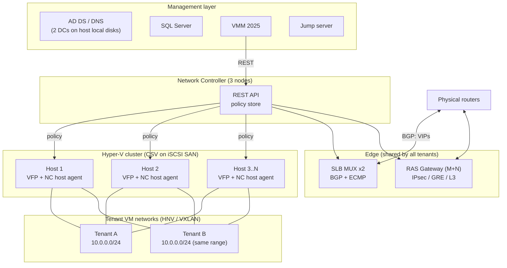

# VMware NSX to Hyper-V SDN: Migration Runbook and Lab

A hands-on project to plan and lab-validate the move of multi-tenant workloads from VMware vSphere with NSX to Windows Server 2025 Hyper-V with Software Defined Networking (SDN), managed by System Center Virtual Machine Manager (VMM) 2025. It contains a phase-by-phase production runbook, a per-tenant onboarding template, and the results of a nested lab on a single Azure VM. The lab tested every design piece before any of it went into the runbook.

## Why

- A multi-tenant hosting environment runs tenant VMs on vSphere, with NSX providing isolation, routing, NAT, load balancing and VPN.
- The target platform is Hyper-V. Every NSX function needs a Hyper-V SDN equivalent before a tenant can move.
- Tenants keep their IP ranges, and the ranges can overlap between tenants. Isolation has to come from the overlay, not from unique addressing.
- Some tenants run their own firewall VMs between their tiers. Those firewalls must stay in the traffic path after migration.

## Architecture

| Layer | Role | Analogy |
|---|---|---|
| VMM | Central management of hosts, networks, templates | vCenter / Kubernetes control plane |
| Network Controller | Holds all SDN state and pushes it to hosts | Kubernetes API server + controllers |
| VFP (on every host) | Enforces isolation, routing, ACLs and NAT per packet | CNI dataplane / kube-proxy |
| VM network (HNV) | A tenant's isolated overlay network | Azure VNet / namespace + Pod CIDR |
| SLB MUX | Public VIPs, inbound and outbound NAT | Azure Load Balancer + NAT Gateway / MetalLB |
| RAS Gateway | Site-to-site VPN, GRE, L3 forwarding per tenant compartment | Azure VPN Gateway / strongSwan in a network namespace |

## Repository structure

| Path | Covers |
|---|---|
| `Production-Runbook/0.0–0.3` | Phase 0: review and master plan, design decisions, the single network and storage team request, as-built record |
| `Production-Runbook/1.1–2.1` | Phases 1–2: host baseline (Windows Server 2025 Datacenter Core, Switch Embedded Teaming, jumbo frames), golden VM image, first domain controller on a host's local disk |
| `Production-Runbook/3.1–5.3` | Phases 3–5: domain join, second DC, AD groups and service accounts, iSCSI SAN + MPIO, 4-node failover cluster with CSV, management jump server |
| `Production-Runbook/6.1–6.6` | Phase 6: SQL Server, VMM 2025, converting the existing SET switch to a VMM logical switch, backup baseline, Cluster-Aware Updating (proxy or WSUS) |
| `Production-Runbook/7.1–7.2` | Phase 7 (optional): SQL Always On, highly available VMM |
| `Production-Runbook/8.0–8.9` | Phase 8: SDN fabric: CA-signed Network Controller certificate (CSR, legacy CSP), SDN library image, 3-node Network Controller, HNV provider network, VIP networks, SLB (2 MUX, BGP + ECMP), RAS Gateway (M+N), operations baseline (backup, certificate expiry, health checks) |
| `Production-Runbook/9.0–9.6` | Phase 9: tenant onboarding template: intake, networking, one VMM cloud per tenant, VM conversion from VMware, cutover and rollback, UDR operations |
| `Customers/<tenant>/` | Values only for one tenant (intake, networking, cloud, migration waves, cutover, as-built), plus `Apply-<tenant>-UDR.ps1`, the idempotent UDR reconcile script |
| `1-Prerequistes/` | Early prerequisite notes |

## The lab

### Environment

| Item | Value |
|---|---|
| Platform | One Azure VM, `Standard_E16s_v5` (16 vCPU / 128 GB), Windows Server 2025 Datacenter, nested Hyper-V |
| Physical network | An internal Hyper-V switch with NAT stands in for the datacenter switches and internet uplink |
| Domain | `contoso.local`, one DC |
| Management | One VM with SQL Server 2022 and VMM 2025 |
| Hyper-V hosts | Two nested hosts |
| SDN | 1 Network Controller (standalone), 1 MUX, 1 RAS Gateway |
| Simulated external devices | A Windows RRAS router (BGP peer and simulated firewall), a branch office VM with RRAS site-to-site VPN |
| Tenants | Tenant A and Tenant B, both on `10.0.0.0/24` |

### Steps

| # | Built | Result |
|---|---|---|
| 1 | Azure VM, Hyper-V, internal switch + NAT | Lab host ready, VMs reach the internet through it |
| 2 | Active Directory and DNS | Domain up |
| 3 | First nested Hyper-V host | A test VM runs inside the nested host |
| 4 | ADK, SQL Server 2022, VMM 2025 | VMM running. Install order matters: ADK, then SQL, then VMM |
| 5 | Host added to VMM | Host managed, network virtualization enabled |
| 6 | Logical networks, IP pool, uplink port profile, logical switch | Switch applied to the host |
| 7 | Sysprepped base VHDX, Network Controller service template, AD groups, Run As accounts | Prerequisites in the VMM library |
| 8 | Network Controller certificate, deployment, network service in VMM | Provider active, NC host agent running, VFP enabled on the host |
| 9 | HNV provider network, Tenant A and Tenant B on the same `10.0.0.0/24` | Same IP in both tenants, no conflict. Tenant B can't reach Tenant A |
| 10 | Second host, tenant VM on it | VXLAN traffic between hosts works after jumbo frames were enabled |
| 11 | SLB MUX, BGP to the router, public VIP for a web tier | Router learns the VIP /32. Traffic alternates between backends per TCP connection |
| 12 | RAS Gateway, IPsec site-to-site VPN to the branch office | Branch reaches Tenant A both ways. Tenant B has no path to the VPN |
| 13 | Inbound and outbound NAT on Tenant B | Port forward to an internal web server works. Outbound traffic leaves as the NAT IP |
| 14 | Second subnet in Tenant A, port ACLs between tiers | Allow + explicit Deny All enforce a tier matrix. ACLs are stateful |
| 15 | Gateway L3 forwarding to a simulated firewall on a VLAN | Routing without NAT: the firewall sees real tenant source IPs. Existing VPN still works |
| 16 | One VMM cloud per tenant, and "Pattern B": a tenant firewall VM kept in the path with user-defined routes through the Network Controller | Traffic between subnets and from VIPs passes the firewall. The firewall's DNAT works on VIP traffic |

## Lessons learned

**Network Controller deployment**
- Microsoft's service templates were written for Windows Server 2016. On 2025, set OS compatibility and the operating system in the template.
- Error 22655 (VMM can't get VM status) means the VMM guest agent isn't installed. Pre-install Visual C++ x64 in the image, or install the agent manually.
- The deployment scripts expect a certificate with a legacy CSP key, not CNG. The production CA template must be legacy CSP.
- `RSAT-AD-PowerShell` must be in the image, or the deployment fails on `Get-ADGroup`.

**Overlay and MTU**
- VXLAN needs an MTU of at least 1674 end to end. A normal ping works while large transfers hang. Test with `ping -f -l 1472`.

**SLB**
- The MUX withdraws a VIP that has no running, healthy backend. A missing BGP route can just mean the backend VM is off.
- Load balancing is per TCP connection, not per HTTP request. Test with keep-alive off.

**VPN**
- A tunnel showed Connected but no traffic passed. The cause was asymmetric routing: the simulated branch sat on the gateway's management network, so replies left through the wrong NIC. Keep management fully separate from tenant and internet ranges.
- After any change to a tenant's connections, re-test every existing connection from both ends. "Connected" isn't proof.

**Port ACLs**
- The default is Allow. An ACL with only Allow rules blocks nothing: add an explicit Deny All.
- ACLs track TCP and UDP, not ICMP, so ping fails where TCP succeeds. Test with TCP.
- VMM can report an ACL change as done while the Network Controller still applies the old rules. Verify in the Network Controller.

**User-defined routes (Pattern B)**
- The /24 system routes are more specific than `0.0.0.0/0`, so a default route alone doesn't steer traffic. List every subnet.
- The next hop must be the firewall's IP in the same subnet as the source.
- A VIP that points directly at a backend bypasses the firewall, because return traffic uses direct server return. Every VIP must target the firewall.
- VMM has no UDR support, and it silently removes UDR links when subnets are added or removed in VMM. The fix is an idempotent reconcile script, a scheduled guard that detects drift, and a change procedure. It's the same problem as Terraform drift.

**Infrastructure**
- Domain controllers go on hosts' local disks, not on the SAN, so AD and DNS stay outside the shared-storage failure domain.

## How to use the runbook

1. Read `0.0` and `0.1` first: the plan and the design decisions.
2. Send the request in `0.2` to the network and storage teams, and wait for the answers. Several later steps depend on them.
3. Run the phases in order, 1 through 9. Phase 7 is optional.
4. Every command block is labeled with the machine it runs on. Run it only there.
5. Every file ends with a **Gate**. Don't start the next file until the Gate passes. Record the results in `0.3`, or in the tenant's as-built file for Phase 9.
6. Values in `<angle brackets>` and the domain name are placeholders. Replace them before you start (see `0.1`).
7. Items marked *to be verified* weren't confirmed in the lab or in Microsoft documentation. Check them in your environment.
8. For each new tenant, copy the Phase 9 template into a new `Customers/<tenant>/` folder and fill in the values.

Nothing here is meant to be run without reading it first.

## Tech stack

- Windows Server 2025 Datacenter: Hyper-V, Failover Clustering, CSV, MPIO, Switch Embedded Teaming, Cluster-Aware Updating
- Hyper-V SDN: Network Controller, HNV (VXLAN), VFP, Software Load Balancer, RAS Gateway, Datacenter Firewall (port ACLs)
- System Center VMM 2025, SQL Server 2022
- Active Directory, AD Certificate Services
- PowerShell
- Source platform: VMware vSphere and NSX

## Status and next steps

| Item | Status |
|---|---|
| Lab (16 steps) | ✅ Complete |
| Production runbook, phases 0–9 | ✅ Written |
| Tenant onboarding template and UDR reconcile script | ✅ Written. The script was tested against mocks |
| First tenant pilot | ⏳ Pending |

## About

Written by a cloud/DevOps engineer with a Linux, Kubernetes and Azure background, learning Windows Server, Hyper-V and SDN through this project. The docs explain Windows concepts through Linux, Kubernetes and Azure analogies.

## Disclaimer

This is a lab and personal learning project, not official Microsoft guidance or a supported design. Validate every step in your own environment before you use it in production.
